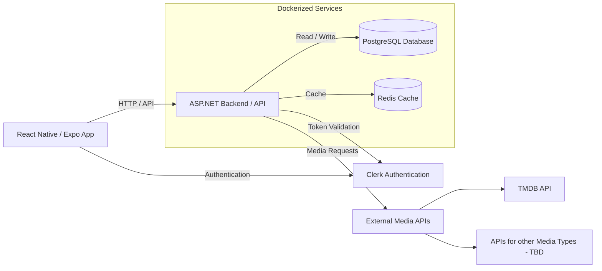

# System Architecture

This document describes the planned system architecture for **Palette**, a cross-media tracking and discovery application. It will be updated as the project evolves and architectural decisions are made.

## 1. Architecture Overview

Palette uses a client-server architecture with a React Native frontend, an ASP.NET backend, and supporting data services.

## 2. Components

### Frontend

- React Native with Expo for cross-platform development.
- Provides user interfaces for searching and interacting with media.
- Communicates with the backend through HTTP APIs.

### Backend

- ASP.NET Core Web API.
- Handles business logic, database operations, and communication
  with external services.
- Uses Entity Framework Core for database access.

### Database

- PostgreSQL 17, hosted locally using Docker Compose.
- Stores application-specific data such as users, media records,
  and other persisted user activity.

### External Services

- TMDB provides movie and TV show information, including
  searchable metadata and media details.

### Authentication

- Clerk handles user authentication.
- The frontend uses Clerk for login, while the backend validates authentication tokens.

### Future Components

- Redis caching may be introduced when needed.
- Additional external media providers may be integrated.
- Cloud deployment infrastructure is not yet finalized.

## 3. Deployment

During local development, PostgreSQL runs in a Docker container,
while the ASP.NET Core backend and Expo frontend run as local
development processes.

The application can be started using the unified development
command described in the Local Setup Guide.

## 4. Future Updates

This architecture represents the current plan and may change during development. This document will be updated as new technologies, services, or architectural decisions are introduced.
