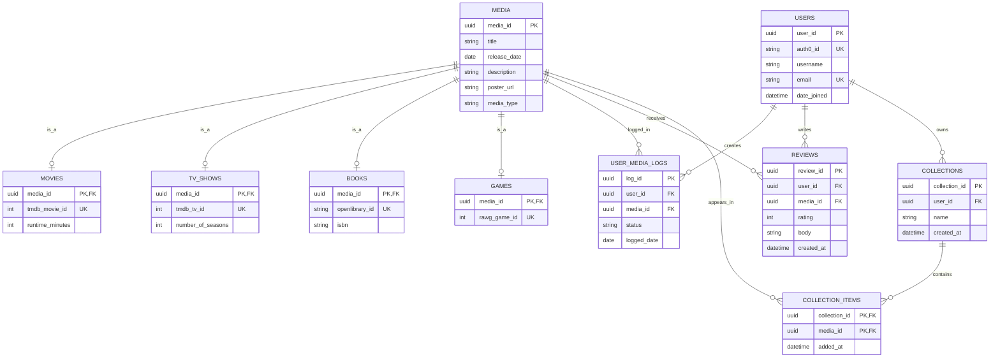

**Implementation Status:** All entities shown in the ER diagram have been implemented, and their corresponding tables have been created in PostgreSQL using EF Core migrations. However, not all entities are currently used by the application's features. Some tables are included to support functionality planned for future sprints.

## ER Diagram

## Database Relationships

The ER diagram uses Crow's Foot Notation to represent cardinality and optionality between entities.

### Relationship Notation

| Symbol | Meaning |
|---|---|
| `\|\|` | Exactly one |
| `o\|` | Zero or one |
| `\|{` | One or many |
| `o{` | Zero or many |

**Cardinality** describes the maximum number of related records (1:1, 1:N, M:N).

**Participation / Optionality** describes whether participation is mandatory (minimum 1) or optional (minimum 0).

### Relationships

**1. Media Specialization — Total and Disjoint**

- **Supertype:** `MEDIA`
- **Subtypes:** `MOVIES`, `TV_SHOWS`, `BOOKS`, `GAMES`
- **Relationship Type:** IS-A (Specialization/Generalization)
- **Disjointness Constraint:** Disjoint — A media record can belong to at most one subtype.
- **Completeness Constraint:** Total — Every media record must belong to at least one subtype.
- Therefore, every media record belongs to exactly one subtype, and each subtype record corresponds to exactly one media record.

**2. Users and Media Logs — One-to-Many (1:N)**

- **User → Media Logs:** Zero or many logs (Optional).
- **Media → Media Logs:** Zero or many logs (Optional).
- **Each Media Log → User:** Exactly one user (Mandatory).
- **Each Media Log → Media:** Exactly one media record (Mandatory).

**3. Users and Reviews — One-to-Many (1:N)**

- **User → Reviews:** Zero or many reviews (Optional).
- **Media → Reviews:** Zero or many reviews (Optional).
- **Each Review → User:** Exactly one user (Mandatory).
- **Each Review → Media:** Exactly one media record (Mandatory).

**4. Users and Collections — One-to-Many (1:N)**

- **User → Collections:** Zero or many collections (Optional).
- **Collection → User:** Exactly one user (Mandatory).

**5. Collections and Media — Many-to-Many (M:N)**

- **Collection → Media:** Zero or many media records (Optional).
- **Media → Collections:** Zero or many collections (Optional).
- Implemented through `COLLECTION_ITEMS`.
- Each collection item references exactly one collection and one media record (Mandatory).

### Notes

- Mermaid ER diagrams cannot directly express Total and Disjoint specialization constraints. These constraints must be enforced separately in the database or application logic.
- Junction tables are used to represent many-to-many relationships.
- Media records are identified internally by `media_id` and externally by provider-specific identifiers.
- External identifiers are unique within their respective media type and provider.
- The database stores media records only when needed for user interactions, rather than maintaining a complete catalogue of external media.
- People, studios, and genres are not stored in separate tables at this stage. These attributes can be retrieved from external APIs for searching, filtering, and displaying media details.
- Additional tables may be introduced in future sprints if new features require persistent relationships or more complex local queries.

---

## External API and Database Integration

Palette uses a hybrid approach that combines external media APIs with PostgreSQL.

### Data Sources

**External Media APIs**

External APIs are responsible for providing searchable media catalogues and metadata.

- **[TMDB](https://developer.themoviedb.org/docs/getting-started):** Movies and TV shows, including titles, directors, creators, cast, genres, production companies, and posters.
- **[OpenLibrary](https://freeapihub.com/apis/open-library):** Book metadata and search functionality (to be finalized).
- **[Rawg](https://rawg.io/apidocs):** Game metadata and search functionality (to be finalized).

Media searches are performed against external APIs rather than being limited to records already stored in PostgreSQL.

**PostgreSQL**

PostgreSQL stores Palette-specific data, including:

- User profiles
- Media records referenced by user activity
- Media logs and tracking statuses
- User ratings and reviews
- Collections and collection items

This design avoids storing an entire external media catalogue while keeping user-generated data persistent.

### Data Storage Strategy

- Search results are retrieved from external APIs without automatically inserting them into PostgreSQL.
- When a user interacts with a media item through an action that requires persistence, the backend checks whether that media item already exists locally.
- If the media item does not exist, the backend creates records in `MEDIA` and the corresponding subtype table.
- If it already exists, the existing record is reused.
- User-generated data references the internal `media_id`.
- Detailed or updated metadata can be retrieved from external APIs when needed.

This approach prevents duplicate media records and reduces unnecessary storage and synchronization.

---

## Example Workflow: TMDB API and PostgreSQL

The following example illustrates how Palette uses TMDB to retrieve movie information and PostgreSQL to store user-related data.

**Scenario: A user searches for and logs *Inception*.**

### 1. Search for Media

- The user searches for "Inception" in the React Native application.
- The frontend sends a search request to the ASP.NET backend.
- The backend queries the TMDB API and returns matching movies.
- Search results are displayed without immediately storing them in PostgreSQL.

### 2. Select a Movie

- The user selects *Inception* from the search results.
- The backend retrieves additional movie details from TMDB, if needed.
- The frontend displays the movie's title, release date, poster, genres, directors, and other available information.
- These details are obtained from TMDB and do not require separate local tables for people, studios, or genres.

### 3. Log the Movie

- The user marks *Inception* as watched.
- The backend checks whether the movie already exists in PostgreSQL using its TMDB movie ID.
- If the movie does not exist, new records are inserted into `MEDIA` and `MOVIES`.
- If the movie already exists, the existing media record is reused.
- A new record is created in `USER_MEDIA_LOGS`, linking the user to the movie.

### 4. Review the Movie

- The user submits a rating and written review.
- The backend creates a record in `REVIEWS`, referencing the user and the existing media record.
- The review is stored in PostgreSQL, not TMDB.

### 5. Retrieve User History

- When the user opens their media history, the backend queries PostgreSQL for their logged media and reviews.
- Stored media metadata is used to display the results.
- TMDB may be queried again if additional or updated movie information is needed.

### 6. Search by Director or Studio

- The user selects a search field, such as Director or Production Company.
- The frontend sends the selected field and search query to the backend.
- The backend uses TMDB to resolve the director or company name to its unique external identifier.
- The backend retrieves matching movies or TV shows using the appropriate TMDB endpoints and available filters.
- Results are returned to the frontend without requiring locally stored people or studio records.
- Movie and TV show credit structures may differ, so creator and director searches are handled according to the available API data.

---

## Key Design Principles

**External APIs**

- Provide searchable media catalogues and detailed metadata.
- Support discovery and filtering without requiring complete local copies of media data.
- Serve as the primary source of external media information.

**PostgreSQL**

- Stores user-related information and selected media records.
- Maintains relationships between users, media, logs, reviews, and collections.
- Reuses existing media records when multiple users interact with the same item.

**ASP .NET Backend**

- Handles communication with external APIs.
- Processes search requests and normalizes responses where necessary.
- Manages database operations and application logic.
- Uses external identifiers to prevent duplicate media records.

**React Native Frontend**

- Provides interfaces for searching and browsing media.
- Displays information obtained from external APIs.
- Allows users to log, review, and organize media.

### Future Considerations

- Recommendation features will be addressed in a later sprint.
- Additional database tables may be introduced if recommendation algorithms or advanced filtering require locally stored metadata.
- External media information may be cached when necessary to improve performance and reduce repeated API requests.
- External API usage, attribution, caching, and data retention must follow the respective providers' terms.

**Media records are shared across users.** If multiple users log the same movie, Palette reuses the existing `MEDIA` record rather than creating duplicates.